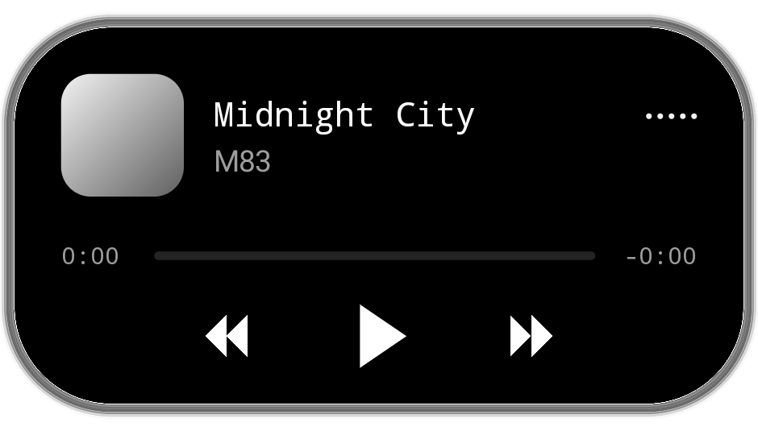
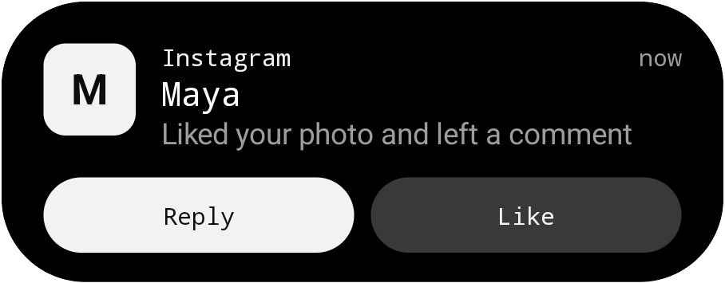
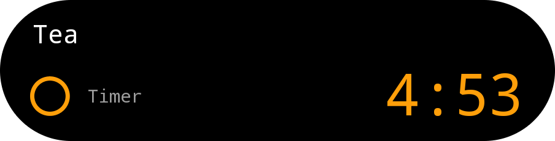
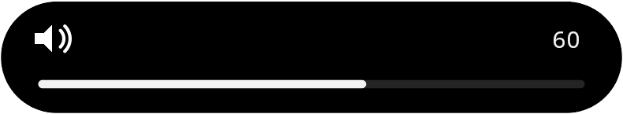
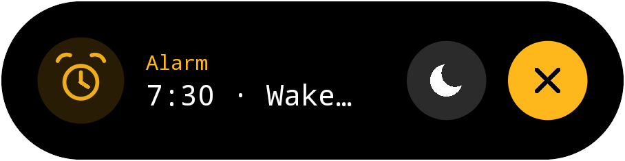
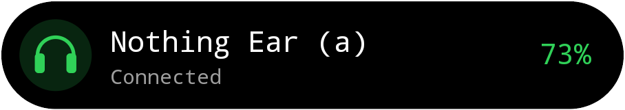
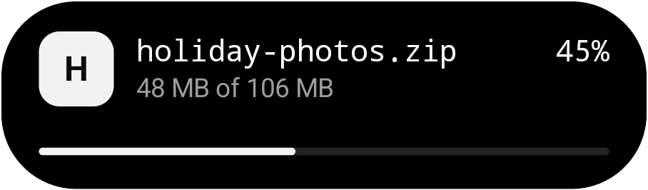
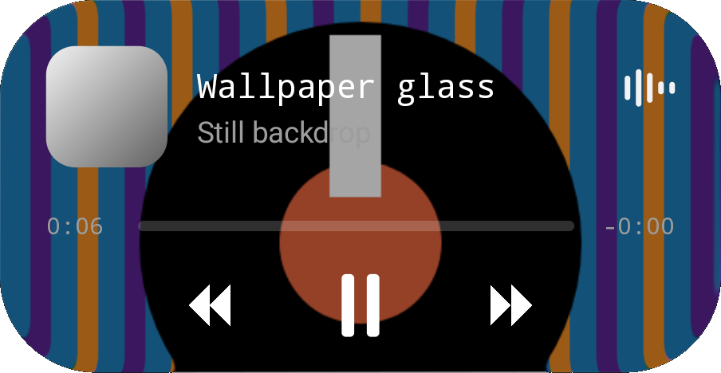

<div align="center">



# Dynamic Droid

**Your camera hole, now alive.**

A Dynamic Island for Android that grows out of your punch-hole camera: music, calls, messages, timers, volume and more, with smooth spring animations.

[**⬇ Download the latest APK**](https://github.com/kavinagarwalagarwal-coder/dynamic-island-polish/releases/latest/download/DynamicDroid.apk) · Android 8.0+ · No internet permission · 13 languages · [Scanned on VirusTotal](https://www.virustotal.com/gui/file/c50be41732d9fc2e0f18ace848ac84a409a7076c78df656a861284666c909476)

</div>

**Install or update:** open the download link on your phone and tap the APK. New versions install over the old one and keep your settings and permissions. Then open the app's **Setup** tab: it walks you through each permission in order, opening the exact switch each time. Using Android 16 or 17? [DynamicDroid-Android17.apk](https://github.com/kavinagarwalagarwal-coder/dynamic-island-polish/releases/latest/download/DynamicDroid-Android17.apk) is built for its newer rules.

---

## Why you'll like it

- **It lives in the camera.** When nothing is happening, the island hides inside the punch-hole. When something happens, it springs out of it, then tucks back in.
- **It moves like the real thing.** Width, height, corners and position all run on springs you can interrupt mid-motion. Numbers roll, bars glide, and a second activity drips off as its own little bubble.
- **It replaces clutter.** The volume slider, the phone's notification pop-ups and the ring/silent toast all move into the island, so you only look in one place.
- **It's private.** The app has no internet permission. It reads notification details to build the island and nothing leaves your phone.

## What it shows

<table>
<tr>
<td width="50%" align="center"><br><b>Messages</b><br>Reply right from the island, or tap a button from the notification.</td>
<td width="50%" align="center"><br><b>Timers</b><br>Live countdown with pause, resume and cancel.</td>
</tr>
<tr>
<td align="center"><br><b>Volume</b><br>Replaces the system slider. Drag it, or hold a volume key to keep going.</td>
<td align="center"><br><b>Alarms</b><br>Snooze or dismiss without opening the clock app.</td>
</tr>
<tr>
<td align="center"><br><b>Headphones</b><br>Connects with a battery level, and warns you when a device drops.</td>
<td align="center"><br><b>Downloads</b><br>Progress for any app that shows a progress bar.</td>
</tr>
</table>

Also: **music** with artwork, a waveform, seeking and controls; **calls** with answer and hang up, plus "Calling…" until the call connects; and **charging**.

### Ring, vibrate and silent, from the island

<p align="center">
&nbsp;
&nbsp;

</p>

Switch the phone between Ring, Vibrate, Silent and Do Not Disturb with the buttons under the volume slider, or tap the ring/silent island to step to the next mode. Whenever the mode changes, the island shows it with a little animation: the bell swings, the phone buzzes, a slash draws across the bell.

### Two things at once

<p align="center"></p>

Music and a timer? The second activity pulls off as a separate bubble. Hold either one to open it.

### Liquid Glass

<p align="center"></p>

Choose your wallpaper and the open island turns into refracting glass.

### Dot music

Tap the album art on the open music island and your song becomes a **spinning record of dots**: the cover redrawn as a halftone of springy dots, ripples on every beat, a ring of dots bouncing like an equaliser around it. Flick the record to skip, tap to pause, drag your finger through the dots. Optionally it follows the real beat of the music.

While music plays, the island itself goes dot too: its whole surface becomes white dots with the cover carved into them, rippling with the beat; the album art in the small pill is a tiny spinning dot record next to a dot equaliser, and the open card holds a bigger record rippling inside its ring of bouncing dots.

The same dot record comes as **four home-screen widgets** (2×2 record, 4×1 strip, 4×2 player and a 4×4 stage) and as a calm **live wallpaper** (just a small dot record, no text) over your own photo that appears only while music plays, switchable from a Quick Settings tile. Everything is under Features → Dot music.

## Make it yours

- **Hide the phone's pop-ups.** One toggle, and the island takes over from the banners that drop from the top. Notifications still land in your shade.
- **Fit your phone.** Scale, nudge and resize the pill to sit perfectly on your camera. Open islands span the screen so they never look lopsided.
- **Look.** Short or tall pill, a soft edge glow, an outline, coloured bubbles, corners that match your screen, and burn-in care.
- **Rules.** Choose which apps can use the island, set priorities, hide it in certain apps, and set quiet hours.
- **Haptics.** Separate switches for tap, hold and swipe, and quiet haptics in Do Not Disturb.
- **Lock screen.** Optionally keep the island on the lock screen.

Every island has a demo in the **Playground**, and a short guided tour teaches the gestures on first launch.

## Gestures

| Do this | To |
| --- | --- |
| Tap | Open the app |
| Hold, or pull down | Expand the island |
| Swipe up | Tuck it away |
| Swipe sideways | Switch between two activities |

## Get started

1. **Download** the APK from [Releases](https://github.com/kavinagarwalagarwal-coder/dynamic-island-polish/releases) and install it. You may need to allow installs from your browser or file manager.
2. **Open Dynamic Droid** and follow Setup:
   - **Notification access** lets the island see your music, messages, timers and calls.
   - **Allow tapping over the status bar** (accessibility) puts the island above the status bar and lets the volume keys drive it.
   - **Display over other apps** is the fallback if you skip the accessibility step.
   - **Optional:** usage access (spotting which app is open), Bluetooth (headphone battery) and Do Not Disturb access (Silent and Do Not Disturb from the island).
3. **Take the tour**, then try each island in the Playground.

Available in English, Hindi, Spanish, Portuguese (Brazil), French, German, Italian, Dutch, Polish, Russian, Turkish, Indonesian and Japanese.

## Security scans

Scan results for the v2 APK (`app-performance.apk` inside the release zip) from two independent malware scanners:

- [**VirusTotal report**](https://www.virustotal.com/gui/file/c50be41732d9fc2e0f18ace848ac84a409a7076c78df656a861284666c909476)
- [**Koodous report**](https://koodous.com/apks/c50be41732d9fc2e0f18ace848ac84a409a7076c78df656a861284666c909476/general-information)

You can check you have the same file. Its SHA-256 is:

```
c50be41732d9fc2e0f18ace848ac84a409a7076c78df656a861284666c909476
```

On a computer, run `sha256sum app-performance.apk` (Linux), `shasum -a 256 app-performance.apk` (macOS) or `certutil -hashfile app-performance.apk SHA256` (Windows).

## FAQ

**Does it drain the battery?**
The island only animates while something is changing. At rest it doesn't redraw, and the small island's waveform runs at 30 fps.

**My phone's camera isn't in the centre.**
Use **Phone fit** to move and resize the pill. Opened islands still centre on the screen.

**Can it hide the phone's own notification pop-ups?**
Yes. Features → *Hide the phone's pop-up notifications*. For pop-ups that never flash at all, there's an optional one-time step from a computer, explained in the app. If you use it, turn the option off before uninstalling.

## For developers

The island's motion is authored in SwiftUI (`Sources/IslandUI`), and the Android app (`android/`) is a native Canvas port with its own overlay, notification listener and accessibility service. Every change is checked on Android emulators in CI.

Build notes, architecture and release history are in **[docs/DEVELOPMENT.md](docs/DEVELOPMENT.md)**.
